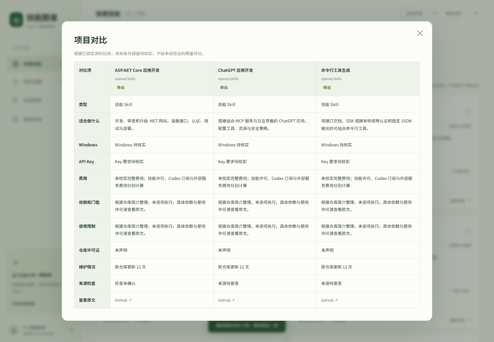

# 小程序合集 · mini-apps

收集和维护实用小程序。欢迎通过 Issue 反馈问题，通过 Pull Request 提交改进。

| 项目 | 用途 | 在线体验 | 源码 |
| --- | --- | --- | --- |
| 技能图谱 | 中文搜索、分类、收藏与对比 Codex Skills | [打开网站](https://codex-skill-atlas.savoryfoal1.chatgpt.site) | [项目说明](apps/codex-skill-atlas/README.md) |

## 快速体验

安装 Node.js 22 或更新版本，在仓库目录运行：

```sh
cd apps/codex-skill-atlas
npm start
```

浏览器打开 http://127.0.0.1:4173。启动不需要安装依赖，也不需要 API Key。

## 一起优化

请先阅读 [贡献指南](CONTRIBUTING.md)。新增小程序放入 apps/独立项目名/，附启动说明，并更新本表。

合并代码不会自动更新线上网站；维护者验证后手动部署。第三方技能仍遵守原仓库许可，详见 [来源说明](THIRD_PARTY_NOTICES.md)。本仓库自有代码使用 [MIT](LICENSE)。

## 界面预览


